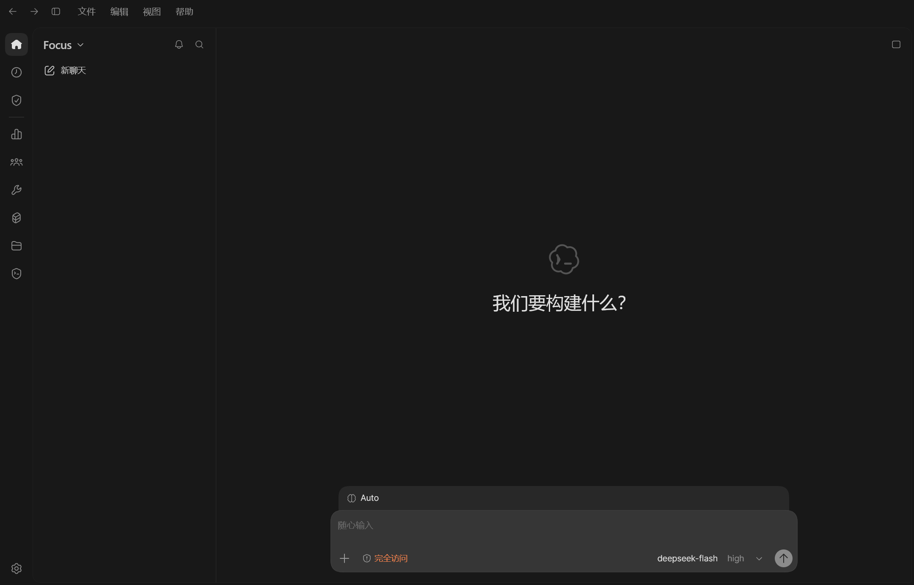
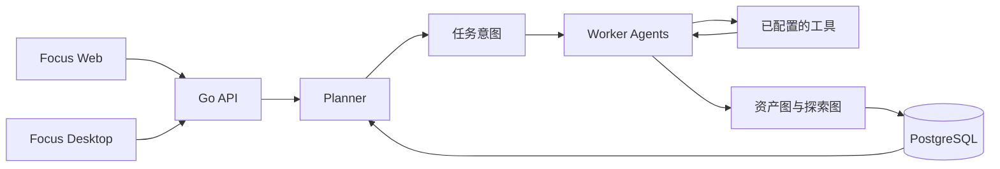

# Focus Agent

[](LICENSE)

Focus Agent 是基于 [Autumn-27/ARTEX](https://github.com/Autumn-27/ARTEX) 二次开发的自主安全测试平台，采用 Go 后端、React/Vite 客户端和 PostgreSQL。它保留上游的 planner/worker 与双图架构，并扩展了会话管理、内网阶段编排、范围审批和部署工具链。

本仓库是独立维护的 `focus-agent` 项目，不依赖 `focus-harness`。产品只有一个 renderer，同一套页面由 Web 与 Electron 两种宿主加载。实现与启动方式见 [前端说明](project/frontends/README.md)。

> **使用范围：**本项目仅供源码学习和本地隔离环境验证。不得用它扫描、探测或测试线上服务及其他联网系统，无论目标归谁所有、是否获得授权。详见[许可与使用限制](#许可与使用限制)。

## 目录

- [项目概览](#项目概览)
- [客户端架构](#客户端架构)
- [功能](#功能)
- [架构](#架构)
- [快速开始](#快速开始)
- [首次访问](#首次访问)
- [使用流程](#使用流程)
- [配置](#配置)
- [能力边界](#能力边界)
- [文档](#文档)
- [开发与构建](#开发与构建)
- [许可与使用限制](#许可与使用限制)

## 项目概览

Focus Agent 以任务为单位组织安全验证：planner 根据当前态势安排工作，worker 调用已配置的工具，把新发现写回资产图和探索图，再由 planner 决定后续步骤。界面用于管理任务、资产、发现结果、会话、审批和流量记录。

项目以 ARTEX v0.3.10 为开发基线，吸收了部分 v0.3.11 / v0.3.12 更新。它遵循上游的 **AGPL-3.0** 许可证。客户端分层和来源见 [前端说明](project/frontends/README.md)。

## 客户端架构

浏览器和 Electron 窗口共用一套 React 页面、状态管理和 API 客户端，源码位于 [`project/frontends/codex-client/`](project/frontends/codex-client)。

| 宿主 | 用途 | 实现 |
| --- | --- | --- |
| Web | 在浏览器打开 `http://127.0.0.1:8787/` | Go 服务提供静态资源与 SPA 回落 |
| Desktop | 常驻托盘的原生窗口 | Electron 加载同一 URL，并提供本机路径选择等白名单能力 |

产品界面统一使用 **Focus** 品牌。Go 包名、`/api` 路径、数据库字段和 `ARTEX_HOME` 等是兼容标识，不属于用户界面。旧 `/artex/*` 地址只做永久重定向，不再提供第二套前端。

<details>
<summary>界面预览</summary>



</details>

## 功能

| 模块 | 说明 |
| --- | --- |
| 任务规划 | planner/worker 多 agent 协作，支持任务暂停、纠偏、审批和过程记录。 |
| 双图数据 | 资产图保存跨任务资产关系；探索图记录每个任务的目标、事实、发现及证据关系。 |
| 内网阶段 | 管理 Webshell 与反弹 Shell 会话、代理隧道、内网拓扑和凭据，并支持从外网阶段移交到内网任务。 |
| 范围与审批 | 支持 RoE 范围策略；发现范围外网段时先进入待审批队列，批准后才纳入任务范围。 |
| 验证与防护 | 按漏洞类别执行反证检查；提供蜜罐静态签名识别、出口信息审查和 tarpit 抓取熔断。 |
| 部署与运维 | 提供 Docker Compose、交互式安装脚本、工具版本清单、自检命令和 systemd unit。 |

## 架构



planner 读取任务态势并生成意图。worker 领取意图、调用工具、记录事实或发现。图数据变化后会唤醒下一轮规划。宿主边界见 [前端说明](project/frontends/README.md)。

## 快速开始

推荐用 Docker Compose 在本地启动。需要 Docker Engine 和 Docker Compose v2。

```bash
git clone https://github.com/XXXXXQ-0206/focus-agent.git
cd focus-agent
cp project/deploy/.env.example .env
```

编辑 `.env`，把 `POSTGRES_PASSWORD` 改成强密码，并使用 URL 安全字符（字母、数字、`.`、`_`、`-`）。不要提交包含真实密码或 API key 的 `.env` 文件。然后构建并启动：

```bash
docker compose up -d --build
docker compose logs -f artex
```

需要单独运行客户端时，先启动 Go 服务，再启动 renderer：

```bash
# Focus renderer（Web / Desktop 共用）
cd project/frontends/codex-client && npm ci && npm run dev -- --port 3000
```

开发服务器默认把 `/api/*` 反代到 `http://127.0.0.1:8787`；可通过
`AUTOPENTEST_API=http://<host>:<port>` 覆盖后端地址。

首次启动时查看日志中的门控入口路径，再按[首次访问](#首次访问)打开界面。

也可以运行交互式安装脚本，它会让你选择全部使用 Docker，或在本机编译运行：

```bash
bash project/install.sh
```

## 首次访问

非回环监听默认启用伪装门控。直接访问 `http://<IP>:8787` 可能只会显示 nginx 欢迎页，这是门控的预期行为。

1. 查看启动日志中的入口路径，例如 `/g-xxxxxxxx`；路径也会写入 `data/gate.path`。
2. 打开 `http://localhost:8787/g-xxxxxxxx`，并按部署配置输入门控口令。默认口令与随机入口路径相同。
3. 首次进入后到 `/init` 设置管理员密码。

## 使用流程

1. 仅在本地隔离靶场中创建任务，并明确填写允许测试的目标和范围。
2. 配置 LLM，并在「工具」页面注册需要使用的外部工具。
3. 查看任务记录和待处理审批；只有确认目标在已授权范围内，才批准范围变更。
4. 检查发现结果及其证据，再决定是否在隔离环境中复测。

## 配置

### 数据库

Docker Compose 部署会启动 PostgreSQL。自行运行二进制时，可编辑 `config.json` 中的数据库字段，或通过 `ARTEX_PG_DSN` 提供连接串：

```json
{
  "database": {
    "host": "127.0.0.1",
    "port": 5432,
    "user": "artex",
    "password": "替换为本地数据库密码",
    "dbname": "artex",
    "sslmode": "disable"
  }
}
```

### LLM 与工具

推荐在界面的「设置 → 模型与 API」页填写模型服务（服务商档案：协议 / 地址 / 密钥 / 模型，外加思考强度、输出上限与收发模式；模型列表由服务端代取）。也可以在 `.env` 中设置 `ANTHROPIC_API_KEY`、`OPENAI_API_KEY` 和 `ARTEX_LLM_*` 参数。密钥只应放在本机配置中，不要写入仓库或日志。

扫描器、隧道和会话工具需按 [`packaging/tools-manifest.json`](packaging/tools-manifest.json) 放置并校验，再到「工具」页面注册。安装完成或升级后可运行 `./artex doctor` 检查数据库、LLM 配置、数据目录和工具链。

其他常用参数：

- `ARTEX_CALLBACK_ADDR`：反弹 Shell 或隧道回连平台所用的地址。
- 源码目录中可用 `sh project/start.sh -addr :8787 -proxy :8788` 分别设置 Web/API 和代理的监听地址。
- Windows 发布包用 `powershell -ExecutionPolicy Bypass -File .\start.ps1` 启动；它会在更新要求重启后重新运行后端。
- 每个任务的 worker 数量可在「系统设置」中调整，默认值为 3。

## 能力边界

- 自动化结果取决于所选模型、工具版本和任务输入；输出不能替代人工复核，也不保证发现所有问题。
- 外部工具需要单独部署和注册。未安装或未配置的工具不会自动可用。
- 蜜罐识别目前包含静态签名层。行为探针和登录后的主机检查仍处于设计阶段；高交互蜜罐可能无法识别。
- 分布式执行仍是评估与设计事项，见 [`FUTURE.md`](project/documentation/FUTURE.md)。

## 文档

| 文档 | 内容 |
| --- | --- |
| [前端说明](project/frontends/README.md) | Focus renderer 与 Web、Electron 宿主的启动和构建方式。 |
| [`HONEYPOT-DETECTION-DESIGN.md`](project/documentation/HONEYPOT-DETECTION-DESIGN.md) | 蜜罐识别与反 AI 蜜罐防护设计。 |
| [`INTRANET-PIVOT-DESIGN.md`](project/documentation/INTRANET-PIVOT-DESIGN.md) | 内网会话、隧道和阶段移交设计。 |
| [`CHAINS-INTEGRATION-DESIGN.md`](project/documentation/CHAINS-INTEGRATION-DESIGN.md) | 场景化思维链与发现验证设计。 |
| [`FUTURE.md`](project/documentation/FUTURE.md) | 分布式执行架构评估，尚未实施。 |
| [`POSTMORTEM-RED-SUN-3.md`](project/documentation/POSTMORTEM-RED-SUN-3.md) / [`AB-REPORT-RED-SUN-3.md`](project/documentation/AB-REPORT-RED-SUN-3.md) | 红日靶场 3 的复盘与 A/B 验证记录。 |
| [`CHANGELOG.md`](project/documentation/CHANGELOG.md) / [`ROADMAP.md`](project/documentation/ROADMAP.md) | 版本变更与项目路线图。 |
| [`TESTING.md`](project/documentation/TESTING.md) | 测试运行说明。 |

## 开发与构建

源码构建需要 Go 1.26.10 或更新版本、Node.js 22 或更新版本，以及可用的 PostgreSQL。Go 模块位于 `backend/`，前端位于 `project/frontends/codex-client/`。Docker 构建会编译前端，由 Go 宿主将其挂载到 `/`。

<details>
<summary>从源码构建单体程序</summary>

```bash
git clone https://github.com/XXXXXQ-0206/focus-agent.git
cd focus-agent

npm --prefix project/frontends/codex-client ci
npm --prefix project/frontends/codex-client run build:static

CGO_ENABLED=0 go -C backend build -tags embedui -o ../artex ./cmd/artex
cp packaging/config.example.json config.json
# 编辑 config.json，填入本地 PostgreSQL 连接信息
sh project/start.sh
```

Ubuntu 18.04 的 glibc 版本低于 Node.js 官方构建要求；这类旧系统需要选用兼容构建或升级系统。国内网络环境可能需要为 Git、npm、Go 模块和 Docker 配置代理或镜像。

</details>

Linux 服务器也可使用 [`packaging/artex.service`](packaging/artex.service) 交由 systemd 管理。部署前请先检查服务监听范围、门控、回连地址和本机密钥权限。

## 许可与使用限制

Focus Agent 按 **GNU Affero General Public License v3.0（AGPL-3.0）** 发布，完整条款见 [`LICENSE`](LICENSE)。本项目基于 [Autumn-27/ARTEX](https://github.com/Autumn-27/ARTEX) 二次开发，上游采用的许可和来源说明见许可证及 [前端说明](project/frontends/README.md)。

如修改本项目并通过网络向用户提供服务，AGPL-3.0 要求向这些用户提供正在运行版本对应的完整源代码；仅提供本仓库链接并不能替代与部署版本相对应的源码。

本项目仅供源码学习和本地隔离环境验证。严禁将其用于任何线上服务或联网系统的扫描、探测、利用或攻击，包括自有系统和已获授权的目标；也不得用于生产环境、数据窃取、勒索、拒绝服务或其他违法行为。使用者须自行遵守适用法律法规，并承担因运行或使用本项目产生的责任。软件按「现状」提供，不附带明示或默示担保。
